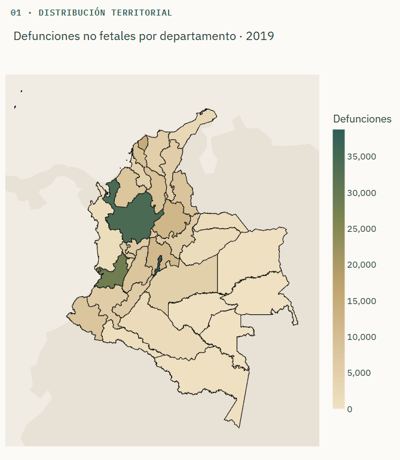
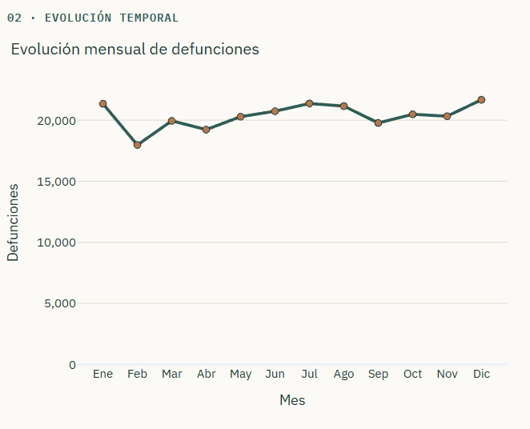
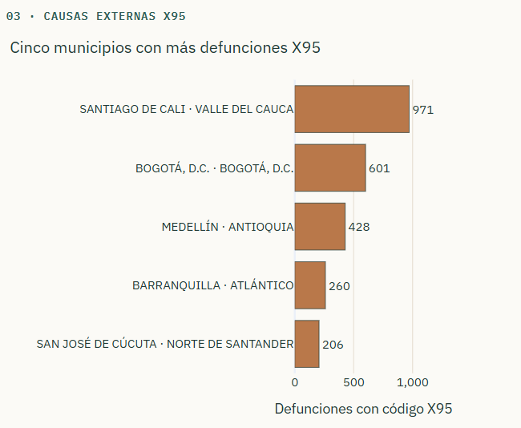
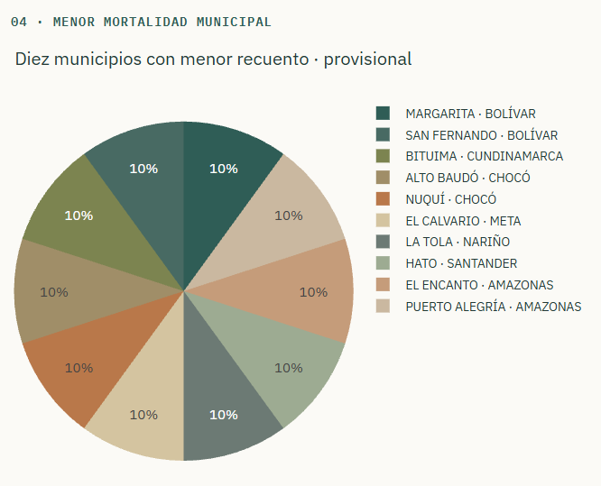
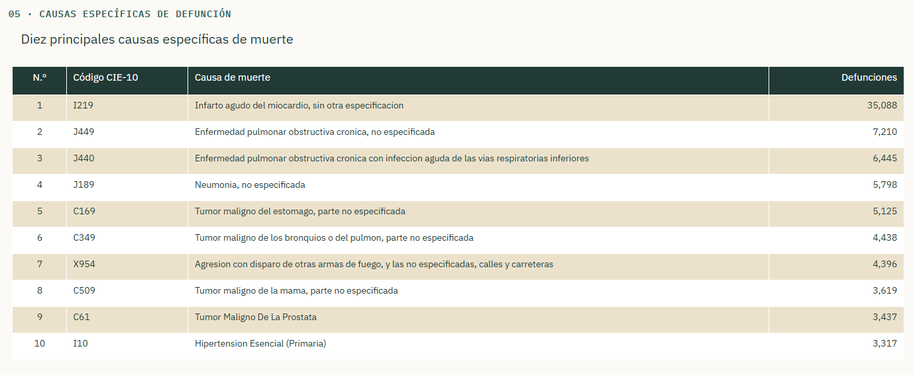
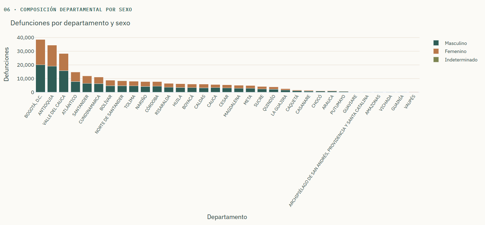
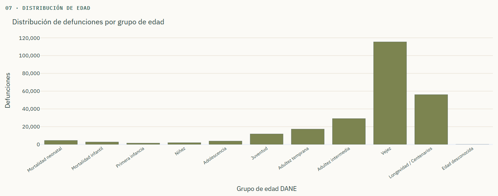

# Colombia 2019: Radiografía de la Mortalidad

**Dashboard interactivo de defunciones no fetales en Colombia, 2019**  
Proyecto académico de la asignatura **Aplicaciones I - GR2** — Maestría en Inteligencia Artificial.

> **Presentado por:** Rodrigo Castellanos Caro  
> **Aplicación pública:** https://github.com/rcastellanospoli/dashboard-mortalidad-colombia-2019/
> **Repositorio GitHub:** https://github.com/rcastellanospoli/dashboard-mortalidad-colombia-2019/
> **Estado:** aplicación desarrollada y probada en Google Colab, publicada en Render a través de este repositorio en GitHub.

## 1. Introducción

Este proyecto presenta una aplicación web construida con **Python, Pandas, Plotly y Dash** para explorar las defunciones no fetales registradas en Colombia durante 2019. Integra siete componentes visuales y filtros por departamento, sexo y grupo de edad, de forma que las representaciones puedan examinarse conjuntamente.

La aplicación permite describir la distribución temporal, territorial y demográfica de las defunciones, consultar las causas específicas más frecuentes e identificar municipios con mayores registros de causas externas correspondientes al prefijo CIE-10 **X95**.

Los resultados son **descriptivos**: el número de defunciones no equivale por sí solo a una tasa de mortalidad ni permite inferir causas o riesgos poblacionales.

## 2. Objetivos

**Objetivo general.** Desarrollar un dashboard interactivo para analizar y comunicar las defunciones no fetales registradas en Colombia en 2019 a partir de las estadísticas vitales del DANE.

**Objetivos específicos.**

- Preparar, verificar y agregar los registros originales para su representación estadística.
- Construir siete visualizaciones con Plotly y una interfaz integrada mediante Dash.
- Implementar filtros simultáneos por departamento, sexo y grupo de edad.
- Documentar los resultados, las decisiones metodológicas y las limitaciones de los indicadores.
- Publicar la aplicación web y proporcionar instrucciones para reproducir su ejecución.

## 3. Fuentes de datos

Fuente principal: **Departamento Administrativo Nacional de Estadística (DANE)**, [Estadísticas Vitales (EEVV) — 2019, Archivo Nacional de Datos](https://microdatos.dane.gov.co/index.php/catalog/696/study-description).

Los archivos utilizados durante la preparación fueron:

- `Anexo1.NoFetal2019_CE_15-03-23.xlsx`: registros de defunciones no fetales.
- `Anexo2.CodigosDeMuerte_CE_15-03-23.xlsx`: descripciones de códigos de causa de muerte.
- `Divipola_CE_.xlsx`: nombres y códigos de departamentos y municipios.

El repositorio **no incluye los tres Excel originales ni los registros individuales**. Incluye cuatro tablas de frecuencias agregadas, comprimidas como CSV en `datos/`: `mensual.csv.gz`, `causas.csv.gz`, `municipios.csv.gz` y `x95.csv.gz`.

Los tres primeros cubos suman individualmente **244.355 defunciones**; `x95.csv.gz` suma **9.273 registros del prefijo X95**. No deben sumarse entre sí los totales de los distintos cubos, porque son vistas agregadas de la misma información.

**Cartografía:** el mapa utiliza límites departamentales simplificados basados en el Marco Geoestadístico Nacional del DANE, distribuidos por el proyecto [ytolosa/mapas-colombia](https://github.com/ytolosa/mapas-colombia).

## 4. Software y tecnologías

| Tecnología | Utilidad en el proyecto |
|---|---|
| Python 3.11 | Lenguaje de desarrollo y versión recomendada del entorno. |
| Pandas | Lectura, procesamiento, agrupación y validación de datos. |
| Plotly Express y Graph Objects | Construcción de gráficos y tabla interactiva. |
| Dash | Interfaz web, filtros, componentes gráficos y callbacks. |
| Requests | Descarga de cartografía cuando no existe una copia local. |
| OpenPyXL | Lectura de los archivos Excel originales al regenerar datos. |
| Google Colab | Entorno utilizado para desarrollo y pruebas. |
| GitHub | Repositorio del código y de la documentación. |
| Gunicorn | Ejecución del servidor de producción. |
| Render | Plataforma prevista para el despliegue;|

### Dependencias declaradas

El archivo `requirements.txt` establece los siguientes **rangos**, no versiones exactas fijadas:

```text
dash>=2.17,<5
plotly>=5.20,<7
pandas>=2.1,<3
requests>=2.31,<3
openpyxl>=3.1,<4
gunicorn>=22,<25
```

## 5. Estructura del proyecto

La carpeta raíz del repositorio contiene los archivos de la aplicación:

```text
mortalidad-colombia-2019/
├── app.py                  # Interfaz Dash, filtros y callbacks
├── graficos.py             # Visualizaciones Plotly
├── modelo.py               # Lectura, validación y filtrado de tablas
├── preparar_datos.py       # Regeneración de los cubos desde los Excel
├── datos/
│   ├── mensual.csv.gz
│   ├── causas.csv.gz
│   ├── municipios.csv.gz
│   ├── x95.csv.gz
│   ├── auditoria.json
│   └── departamentos.geojson 
├── assets/
│   └── estilos.css         # Identidad visual y diseño adaptable
├── pruebas/
│   └── verificar.py        # Comprobaciones estadísticas y de figuras
├── captura/               # Imagenes de las visualizaciones
├── requirements.txt
├── render.yaml             # Configuración para Render
├── .python-version
├── .gitignore
├── RESULTADOS_PRUEBAS.txt
└── README.md
```

## 6. Instalación y ejecución local

**Requisitos:** Python 3.11, acceso a una terminal y los archivos del repositorio.

1. Descargar o clonar el repositorio.
2. Abrir una terminal en la carpeta que contiene `app.py`.
3. Crear un entorno virtual e instalar las dependencias.
4. Ejecutar las pruebas y después iniciar Dash.

```bash
python -m venv .venv
```

Activar el entorno en **Windows (PowerShell)**:

```powershell
.venv\Scripts\Activate.ps1
```

O en **Linux/macOS**:

```bash
source .venv/bin/activate
```

Instalar dependencias y ejecutar:

```bash
pip install -r requirements.txt
python pruebas/verificar.py
python app.py
```

Abrir [http://127.0.0.1:8050](http://127.0.0.1:8050). Los Excel originales no son necesarios para ejecutar la aplicación porque ya se incluyen los cubos agregados.

### Regeneración de los datos agregados

Si se dispone de los tres Excel originales, ejecutar desde la raíz del proyecto:

```bash
python preparar_datos.py \
  --defunciones Anexo1.NoFetal2019_CE_15-03-23.xlsx \
  --causas Anexo2.CodigosDeMuerte_CE_15-03-23.xlsx \
  --divipola Divipola_CE_.xlsx \
  --salida datos

python pruebas/verificar.py
```

## 7. Visualizaciones y análisis de resultados

El dashboard presenta siete visualizaciones interactivas que permiten explorar las defunciones no fetales registradas en Colombia durante 2019 desde distintas perspectivas: territorial, temporal, demográfica y según las causas de muerte.

Los resultados descritos a continuación corresponden al conjunto nacional, con los filtros de departamento, sexo y grupo de edad configurados en **Todos**. Al modificar cualquiera de estos filtros, las visualizaciones y los indicadores se actualizan para reflejar la selección realizada.

Los análisis se fundamentan principalmente en frecuencias absolutas. Por tanto, las diferencias observadas entre territorios o grupos poblacionales no deben interpretarse directamente como diferencias en el riesgo de mortalidad.

### 7.1. Distribución territorial de las defunciones

**Visualización:** mapa coroplético que representa el número de defunciones no fetales por departamento y Bogotá, D. C. La intensidad de los colores permite identificar las diferencias en la cantidad de registros entre las 33 unidades territoriales consideradas.



*Figura 1. Distribución territorial de las defunciones no fetales en Colombia durante 2019.*

**Interpretación.** Bogotá, D. C. registra **38.760 defunciones**, seguida de Antioquia, con **34.473**, y Valle del Cauca, con **28.443**. Estos territorios presentan los mayores recuentos de la base de datos y destacan visualmente por la intensidad de sus colores.

La distribución evidencia diferencias territoriales importantes. Sin embargo, los resultados corresponden a números absolutos y no a tasas de mortalidad. En consecuencia, los mayores recuentos pueden estar asociados, entre otros factores, con diferencias en el tamaño de las poblaciones.

El mapa permite comparar los registros atribuidos a cada territorio en la base utilizada, pero no establece por sí mismo cuáles departamentos presentan un mayor riesgo de mortalidad.

### 7.2. Evolución mensual de las defunciones

**Visualización:** gráfico de líneas que representa el comportamiento mensual de las defunciones no fetales registradas durante los doce meses de 2019.



*Figura 2. Evolución mensual de las defunciones no fetales registradas en Colombia durante 2019.*

**Interpretación.** Durante 2019 se registraron **244.355 defunciones no fetales**. Diciembre presentó el mayor número de registros, con **21.678 defunciones**, mientras que febrero registró el menor, con **17.974**.

Aunque la cantidad de defunciones fluctúa durante el año, la mayoría de los meses presenta valores cercanos a los 20.000 registros. Después de la disminución observada en febrero, la serie muestra variaciones moderadas, con nuevos incrementos durante julio y diciembre.

El gráfico facilita la identificación de diferencias temporales. No obstante, el análisis de un único año no permite determinar la existencia de patrones estacionales ni establecer las causas de estas variaciones.

### 7.3. Causas externas: código CIE-10 X95

**Visualización:** gráfico de barras horizontales que identifica los cinco municipios con mayor número de defunciones asociadas con códigos de la Clasificación Internacional de Enfermedades (CIE-10) que comienzan por `X95`.



*Figura 3. Cinco municipios con mayor número de defunciones asociadas con el prefijo CIE-10 X95.*

**Interpretación.** Santiago de Cali presenta el mayor número de registros, con **971 defunciones**, seguido de Bogotá, D. C., con **601**; Medellín, con **428**; Barranquilla, con **260**; y San José de Cúcuta, con **206**.

Los resultados muestran diferencias considerables entre los cinco municipios seleccionados, con un predominio de los registros correspondientes a Santiago de Cali.

El prefijo `X95` se relaciona con agresiones mediante disparo de otras armas de fuego y armas no especificadas. Por esta razón, **los resultados representan exclusivamente las defunciones clasificadas bajo este grupo de códigos y no la totalidad de los homicidios** registrados en Colombia.

Asimismo, las diferencias observadas corresponden a frecuencias absolutas y no permiten establecer directamente el riesgo relativo entre municipios.

### 7.4. Municipios con menor mortalidad: comparación provisional

**Visualización:** gráfico circular que presenta diez municipios seleccionados por registrar los menores recuentos positivos de defunciones en la base de datos.



*Figura 4. Distribución porcentual de los registros de defunción entre diez municipios con los menores recuentos positivos.*

**Interpretación.** Los municipios representados son Margarita y San Fernando (Bolívar), Bituima (Cundinamarca), Alto Baudó y Nuquí (Chocó), El Calvario (Meta), La Tola (Nariño), Hato (Santander), y El Encanto y Puerto Alegría (Amazonas).

Cada uno presenta **una defunción registrada**, por lo que los sectores del gráfico tienen la misma proporción del **10 %**. La igualdad entre los sectores refleja un empate en los recuentos y no diferencias en las condiciones de mortalidad de estos municipios.

Es importante señalar que **un menor número de defunciones no implica necesariamente una menor tasa de mortalidad**. Un municipio con una población reducida puede registrar pocos fallecimientos y, aun así, presentar una tasa relativamente elevada.

Para establecer una comparación mediante tasas brutas de mortalidad sería necesario disponer de la población municipal correspondiente a 2019 y calcular:

**Tasa bruta de mortalidad = (Número de defunciones / Población) × 100.000**

Además, los numeradores y denominadores deben corresponder al mismo criterio territorial. Para una tasa basada en población residente, por ejemplo, deben utilizarse las defunciones de residentes del municipio.

Dado que el proyecto no incorpora estos denominadores, la visualización se presenta expresamente como una **comparación provisional de recuentos absolutos**, excluyendo municipios sin registros. La selección tampoco constituye un ranking único, debido a los empates existentes entre municipios.

### 7.5. Diez principales causas específicas de defunción

**Visualización:** tabla que presenta las diez causas específicas de muerte más frecuentes durante 2019, identificadas mediante su código CIE-10, descripción y número de defunciones.



*Figura 5. Diez principales causas específicas de defunción registradas en Colombia durante 2019.*

**Interpretación.** La principal causa específica registrada corresponde al código **I219**, infarto agudo del miocardio sin otra especificación, con **35.088 defunciones**.

En segundo lugar aparece el código **J449**, enfermedad pulmonar obstructiva crónica no especificada, con **7.210 registros**, seguido de **J440**, enfermedad pulmonar obstructiva crónica con infección aguda de las vías respiratorias inferiores, con **6.445**.

También se encuentran entre las principales causas la neumonía no especificada, algunos tumores malignos, las agresiones con armas de fuego y la hipertensión esencial.

Estos resultados muestran la relevancia de las enfermedades cardiovasculares y respiratorias entre los principales diagnósticos registrados. Sin embargo, el ordenamiento se realiza por **código CIE-10 específico**, por lo que no debe interpretarse como una clasificación consolidada por grandes grupos de enfermedades.

### 7.6. Composición departamental por sexo

**Visualización:** gráfico de barras apiladas que compara las defunciones de cada departamento según las categorías de sexo registradas en la base de datos.



*Figura 6. Distribución departamental de las defunciones no fetales según sexo.*

**Interpretación.** Durante 2019 se registraron **134.573 defunciones masculinas**, **109.689 femeninas** y **93 con sexo indeterminado**.

En términos absolutos, las defunciones masculinas superan a las femeninas en el conjunto nacional. Esta diferencia también se observa en numerosos departamentos.

Bogotá, Antioquia y Valle del Cauca presentan los mayores volúmenes de registros, lo que resulta consistente con la distribución territorial mostrada en el mapa.

El uso de barras apiladas permite comparar tanto el total de defunciones como su composición por sexo en cada territorio. No obstante, para analizar diferencias en el riesgo de mortalidad entre hombres y mujeres sería necesario calcular tasas específicas utilizando las poblaciones correspondientes.

### 7.7. Distribución por grupos de edad

**Visualización:** gráfico de barras que representa las defunciones según once categorías de edad construidas a partir de los códigos de la variable `GRUPO_EDAD1` del archivo utilizado en el proyecto.

Las equivalencias de los códigos se contrastaron con la variable oficial `GRU_ED1` del diccionario de Estadísticas Vitales 2019 del DANE. Las denominaciones de las once categorías corresponden a agrupaciones analíticas utilizadas en el dashboard.



*Figura 7. Distribución de las defunciones no fetales según las categorías de edad definidas en el proyecto.*

**Interpretación.** La categoría denominada **Vejez**, correspondiente a las edades de **60 a 84 años**, concentra el mayor número de registros, con **115.453 defunciones**.

Le sigue **Longevidad / Centenarios**, que agrupa las edades de **85 años o más**, con **56.061 registros**. Posteriormente aparecen Adultez intermedia, correspondiente a las edades de 45 a 59 años, con **29.105 defunciones**, y Adultez temprana, de 30 a 44 años, con **17.276**.

La distribución muestra que los mayores recuentos de defunciones se concentran en los grupos de edades avanzadas, mientras que las categorías correspondientes a etapas más tempranas de la vida presentan frecuencias considerablemente menores.

Para interpretar correctamente las etiquetas del gráfico, es importante aclarar que:

- **Mortalidad neonatal:** agrupa los códigos correspondientes a menores de un mes, incluidos los registros de 28 y 29 días.
- **Mortalidad infantil:** representa, en esta clasificación particular, las edades de 1 a 11 meses, sin incluir los registros de menores de un mes.
- **Longevidad / Centenarios:** comprende todas las edades desde los 85 años, por lo que no se refiere exclusivamente a personas centenarias.

Estas denominaciones se conservaron en la aplicación como parte de la clasificación implementada, pero sus intervalos deben interpretarse conforme al diccionario oficial del DANE.

Los valores representan frecuencias absolutas y no tasas específicas por edad. Por ello, la concentración de defunciones en los grupos de edades avanzadas no permite cuantificar directamente las diferencias de riesgo sin considerar la población correspondiente a cada intervalo.

**Referencia:** DANE. *Estadísticas Vitales 2019, diccionario de variables*. [Consultar diccionario oficial](https://microdatos.dane.gov.co/index.php/catalog/696/data-dictionary/F23?file_name=nofetal2019).

### 7.8. Consideraciones generales del análisis

En conjunto, las siete visualizaciones permiten identificar patrones descriptivos de la mortalidad no fetal registrada en Colombia durante 2019.

Los resultados muestran diferencias territoriales en la cantidad de defunciones, variaciones a lo largo del año, una mayor frecuencia de registros masculinos y una concentración importante de fallecimientos en los grupos de edades avanzadas. También permiten identificar las causas específicas más frecuentes y explorar una categoría particular de causas externas.

El uso de filtros interactivos facilita profundizar en estas distribuciones y comparar subconjuntos de la información sin modificar la base original.

No obstante, los resultados deben interpretarse dentro de las limitaciones de los datos y de las variables utilizadas. En particular, **los recuentos absolutos no equivalen a tasas de mortalidad**, y las diferencias observadas no permiten establecer relaciones causales ni comparaciones directas de riesgo entre poblaciones.

De esta manera, el dashboard constituye una herramienta para la exploración y comunicación de información estadística, que permite reconocer patrones generales y formular preguntas para análisis posteriores.


## 8. Consideraciones y limitaciones metodológicas

- **Conteos frente a tasas.** El número absoluto de defunciones no es una tasa de mortalidad. Para tasas brutas municipales se necesitan denominadores de población municipal de 2019 y criterios territoriales compatibles.
- **Población opcional.** El programa permite incorporar `datos/poblacion_municipal_2019.csv` con columnas `COD_DANE,POBLACION_2019`, códigos de cinco caracteres y población positiva. Solo utiliza tasas generales cuando hay cobertura suficiente y no se filtra por edad o sexo.
- **Filtro por sexo y edad.** No se calcula una tasa específica utilizando como denominador la población total de todas las personas.
- **Codificación X95.** Este prefijo corresponde a una causa externa específica; no abarca todas las formas de homicidio ni sustituye la clasificación por manera de muerte.
- **Causas específicas.** Los códigos CIE-10 se ordenan individualmente; no representan necesariamente agrupaciones clínicas amplias.
- **Edades.** Los resultados usan agrupaciones derivadas del registro original. Sus límites deben estar documentados y contrastados con el diccionario de la fuente.
- **Comparaciones.** Diferencias entre territorios pueden estar influidas por tamaño y composición poblacional. Las visualizaciones son descriptivas y no establecen relaciones causales.


## 9. Despliegue de la aplicación

La aplicación fue desarrollada con Python, Plotly y Dash, y está preparada para su publicación como servicio web mediante un repositorio de GitHub.

El proyecto incluye el archivo `requirements.txt`, con las dependencias necesarias para su ejecución, y expone el servidor Flask de Dash mediante `server = app.server`.

Para ejecutar la aplicación en un entorno de producción se utiliza Gunicorn con el siguiente comando:

```bash
gunicorn app:server --bind 0.0.0.0:$PORT --workers 1 --timeout 120
```

El despliegue puede realizarse conectando el repositorio de GitHub con un servicio de alojamiento compatible con aplicaciones Python, como Render.

**Repositorio GitHub:** [Enlace al repositorio](https://github.com/rcastellanospoli/dashboard-mortalidad-colombia-2019)

**Dashboard publicado:** [Acceder a la aplicación](https://github.com/rcastellanospoli/dashboard-mortalidad-colombia-2019/)


## 10. Créditos y referencias

- **DANE.** [Estadísticas Vitales (EEVV) — 2019](https://microdatos.dane.gov.co/index.php/catalog/696/study-description). Archivo Nacional de Datos.
- **DANE.** Marco Geoestadístico Nacional. Fuente institucional: [www.dane.gov.co](https://www.dane.gov.co/).
- **Cartografía simplificada.** [ytolosa/mapas-colombia](https://github.com/ytolosa/mapas-colombia), repositorio cartográfico basado en MGN DANE; consultar las condiciones de atribución y licencia del proyecto.
- **Visualización e interfaz.** [Plotly](https://plotly.com/python/) y [Dash](https://dash.plotly.com/).

